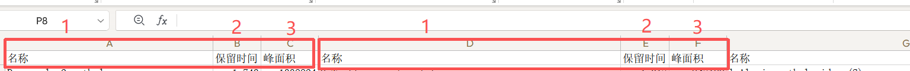
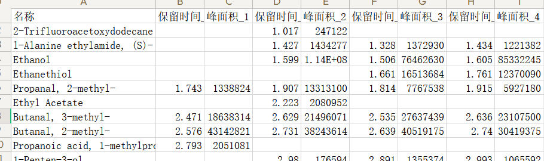

# FP-DataHelper
**version: 0.3.2**

---

## 安装方法

<details>
<summary>自己安装使用</summary>

- **Windows x64 完整包**带有 Python 和所需依赖，下载并解压后双击 `启动.bat`。电脑上没有 Python 时可以选这个包。[下载发布包](https://github.com/Funny1Potato/FP-DataHelper/releases/latest)
- **普通包或源码**需要 Python 3.10 或更新版本。在程序目录打开终端，执行 `python -m pip install -r Requirement.txt` 安装依赖，然后双击 `启动.bat`，或运行 `python Datahelper.py`。

</details>

<details>
<summary>给 AI 工具安装（实验性功能）</summary>

如果你使用 Codex、WorkBuddy、DeepSeek Harness 等 AI 工具，把下面这段文字发给它。

```text
请帮我安装 FP-DataHelper Skill。项目仓库是 https://github.com/Funny1Potato/FP-DataHelper
如果已有本地项目，就用现有副本。请读取项目里的 INSTALL-SKILL.md，按说明安装并运行样例验证。安装好后，告诉我怎么用它处理 Excel。
```

AI 工具需要能访问本地文件和运行终端。Windows x64 可以使用完整包内置的 Python。

</details>

## 使用方法

<details>
<summary>自己使用桌面程序</summary>

1. 双击 `启动.bat` 打开程序。
2. 选择处理方法和待处理的 `.xlsx` 文件，按提示填写参数。
3. 点击 `运行`。程序每次生成独立文件，结果保存在 [output](./output) 文件夹。需要串联多个步骤时可用[批量执行](#批量执行)。

</details>

<details>
<summary>用 AI 工具处理文件（实验性功能）</summary>

把 Excel 文件交给 AI 工具，用日常语言说想要的结果。也可以先请它看一下文件，帮你选处理方法。

- 「先看看这份峰表，告诉我能做哪些处理。」
- 「把不同样品里同名的峰排到一行，保留时间最多差 0.5 分钟。」
- 「查这些化合物的嗅觉阈值，并标出可能的含硅化合物。」

AI 工具会用 `fp-datahelper` 处理文件，并在发现有新版时提示你。对齐、RI 和阈值等方法的详细说明见下文。

</details>

---

## 功能一览

| 分类 | 方法 | 功能 |
|------|------|------|
| 主程序 | **Sorter-0.1.0** | 多组色谱数据对齐排序 |
| 扩展模块 | **CAS_to_Threshold** | 根据 CAS 号查询嗅觉阈值 |
| 扩展模块 | **Threshold_Full** | 根据 CAS 号/名称查询嗅觉阈值（完整库，支持多种筛选模式） |
| 扩展模块 | **RI_Calculator** | 计算保留指数（Kovats/线性） |
| 扩展模块 | **Si_Marker** | 标记含硅化合物 |
| 移植内容 | **Name_to_CAS--AromaNexus** | 根据化合物名称查询 CAS 号 |
| 移植内容 | **Cb_Spider--AromaNexus** | 根据 CAS 号查询香气属性 |
| 主程序 | **批量执行** | 多方法串联执行，支持预设工作流 |
| 主程序 | **自动更新** | 启动时自动检查新版本，一键下载更新 |

---

## 主程序

### 数据整理

待处理文件须按一定的要求编辑后方可进行处理，可按照下文中的要求或参考 [example.xlsx](./example.xlsx) 的样式编辑。

#### 自动分组

参数2留空时，程序从表头的两列或更多「时间」判断分组宽度，并检查每组是否都有一列「名称」。



- 如图所示，程序会根据两个“时间”列之间的距离自动判断各组的列数，表格须保持各组列数相等，如图中各组均为3列
- “时间”列用于排序，“名称”列用于判断是否为同一物质。须保证每组内各有一列“时间”和“名称”，“时间”和“名称”的顺序没有要求，若识别失败，请将“时间”列置于“名称”之前。
- 若表头上方有其他内容，程序不会进行处理，将按照原样保留在输出的文件内。

#### 手动分组

填写参数2后，程序按指定列数从第一列开始切分。每组至少两列，且工作表的有效列数须为组宽的整数倍。若识别出组内的时间和名称列，就使用表头指示的位置。否则将每组的前两列依次作为时间和名称。

程序会在前 20 行寻找含「时间」和「名称」的表头。使用无法自动识别的表头时，请将表头放在第一行。

#### 名称对齐



如图所示，为便于后续处理，程序会将判断为相同物质的数据合并为同一行，并将“名称”列统一移至第一列。

#### 时间阈值

对齐时需要设定时间阈值（单位：min），以避免误将不同物质合并的情况，当两物质的"时间"差异大于该阈值时，程序将不会合并这两个物质。

#### 参数说明

- 参数1：（必填）时间偏差阈值
- 参数2：（可选）每组数据列数。留空自动识别，填写则使用手动分组

#### 输出工作簿

- 新版排序保留表头上方的内容及合并单元格，并随对齐后的数据保留单元格格式。排序区域含合并单元格、表格或其他依赖原位置的对象时，日志会列出无法直接重排的工作表。
- 排序输出为独立工作簿，排序后的数据使用原工作表名，每张成功排序的表只出现一次。输出中的公式单元格写入源文件已保存的计算值。没有计算值时，结果以 `#N/A` 标记，涉及的工作表会跳过排序并在日志中提示先用 Excel 重算并保存。
- 阈值、CAS、香气属性和 RI 方法在原工作簿的副本上增加结果列。如果插列会影响公式、表格、筛选、合并单元格等已有布局，结果列会放到工作表右侧。含硅标记只修改命中名称的字体颜色。
- 程序会在日志末尾列出跳过的工作表和原因。支持跳过的功能在没有任何工作表成功处理时报告失败。

---

### 批量执行

点击主界面 `批量执行` 按钮打开批量执行对话框，可将多个方法按顺序串联执行，前一个方法的输出文件自动作为下一个方法的输入。

#### 使用方法

1. 点击 `添加方法` 按钮，选择要执行的方法并填写参数
2. 重复上一步，添加所有需要的方法（可使用 ↑↓ 按钮调整顺序）
3. 点击 `选择文件` 选择第一个任务的输入文件
4. 点击 `执行` 开始批量处理

#### 预设工作流

常用的方法组合可以保存为预设工作流，方便下次直接使用：

* 在批量执行对话框中编排好任务后，点击 `保存` 按钮，输入名称即可保存
* 下次打开批量执行对话框时，可从下拉框中选择已保存的预设快速加载
* 程序内置了 `推荐预设`（排序 → CAS号查询 → 阈值查询 → 香气属性查询 → 含硅标记）

#### 注意事项

* 若方法报错或没有生成结果文件，批量会暂停。重试使用该任务原本的输入，跳过则把同一份输入交给下一步。若第一个任务被跳过，下一步仍使用最初选择的文件。
* 点击 `停止批量` 会结束当前任务并取消后续任务。实时日志显示在主界面。香气属性查询暂停等待输入时，可以在主窗口输入区按回车重试，或输入 `n` 后按回车跳过当前物质。

---

### 自动更新

程序启动时会自动检查 GitHub 上的最新版本，若有新版本可用则弹窗提示。

#### 使用方法

* **自动检查**：程序启动时自动在后台检查更新，若发现新版本会弹出提示窗口，显示版本号和更新内容
  * 点击 `立即更新`：自动下载更新包并替换当前程序，完成后提示重启
  * 点击 `跳过此版本`：本次不更新
  * 点击 `稍后再说`：本次不更新，下次启动仍会提示
* **手动检查**：点击 `选项` 按钮打开设置对话框，点击 `立即检查更新` 手动触发检查
* **关闭自动检查**：在设置对话框中取消勾选 `启动时自动检查更新`

#### 注意事项

* 自动更新功能需要能够访问 GitHub，若网络不通则检查会静默失败
* 更新完成后需要重启程序才能生效
* 更新器先验证和备份要替换的程序文件，替换失败时会回滚已更新的文件。个人设置和预设保存到 `user_data/`，程序也能读取旧版 `config/` 中的个人配置。更新器保留这些配置以及 `output/` 下的历史输出。

---

## 扩展模块

### 嗅觉阈值查询

已将《化合物嗅觉阈值汇编》（第二版，科学出版社）中物质在水中的嗅觉阈值整理成简易数据库，可通过CAS号快速查找物质对应的嗅觉阈值。

- 在 `方法` 栏中选择 `CAS_to_Threshold`，点击 `选择文件` 按钮选择需要处理的文件，点击 `运行` 按钮即可进行处理。
- 程序会在前 20 行查找常见 CAS 表头，并在 CAS 列后添加嗅觉阈值。使用自定义列名时，将表头放在第一行，并在 `参数1` 填写列字母，例如 `A` 或 `B`。
- 程序仅能对CAS号进行处理，不支持通过名称搜索，若只有名称，请先使用 [CAS号查询](#cas号查询) 模块。
- 精简库按原有的最小值口径记录物质在水中的嗅觉阈值。程序按 CAS 直接查询精简库的预存数值。如需其他阈值，可使用完整版查询。

#### 参数说明

- 参数1：（可选）CAS号列位置

---

### 嗅觉阈值查询（增强）

基于完整版水中阈值数据库（《化合物嗅觉阈值汇编》第二版）的高级查询功能，支持更丰富的数据和灵活的筛选模式。数据库包含 1771 个化合物，每个化合物记录了多条阈值数据（包括值、单位、研究者、年份、类型等信息）。

* 在 `方法` 栏中选择 `Threshold_Full`，点击 `选择文件` 按钮选择需要处理的文件，点击 `运行` 按钮即可进行处理。
* 程序支持三种运行模式：
  * **默认模式**（`d`）：自动取每个化合物最新年份的阈值
  * **自定义模式**（`c`）：弹窗选择匹配方式（CAS号/名称）、阈值选择（最新值/最大值/最小值）、类型筛选（全部/detection/recognition）
  * **手动模式**（`m`）：弹窗选择匹配方式后，对每个化合物逐行弹出选择窗口，可手动选择要使用的阈值记录
* 默认模式自动识别 CAS 或名称列。两列都存在时先查 CAS，查不到再按名称匹配。如需指定 CAS 列，在 `参数1` 输入列字母。
* 自定义模式按指定类型筛选时，只使用标注为该类型的阈值。手动模式的「取消处理」会终止本次执行，结果文件不会保存。
* 匹配到的阈值单位统一为 mg/L。

#### 参数说明

- 参数1：（可选）CAS号列位置
- 参数2：（可选）运行模式（默认 `d`）
  - `d`：默认模式，取最新阈值
  - `c`：自定义模式，弹窗设置筛选条件
  - `m`：手动模式，逐行选择阈值记录

---

### 保留指数计算

根据正构烷烃参考数据计算保留指数（RI），支持 Kovats 对数插值和线性插值两种公式，可选查询 NIST 数据库进行对比。

#### 参数说明

- 参数1：（必填）正构烷烃参考文件路径（.xlsx，两列为碳数和保留时间，参考 [exampleRI.xlsx](exampleRI.xlsx)）。碳数须是不重复的正整数，保留时间须为正并随碳数递增。缺少中间标样时，在能夹住目标峰的两个参考点间按实际碳数间距插值。可点击输入框右侧 `...` 选择文件。
- 参数2：（可选）公式,聚合方式（默认 `L,A`）
  - `公式` 即保留指数的计算公式，支持对数插值及线性插值，默认线性插值。`L`=线性，`K`=Kovats，`B`=两者
  - `聚合方式` 即用于计算化合物RI的保留时间选择方式，程序提供三种选项，默认为取平均时间。`A`=平均，`MIN`=最小，`MAX`=最大

- 参数3：（可选）CAS列,名称列（默认自动识别）

计算完成后，程序会询问是否查询 NIST 数据库（查询方式参考 [CAS号查询](#cas号查询) ）。

---

### 含硅化合物标记

许多自然中不存在含硅化合物，因此在一些领域中，检测到的含硅物质需要作为杂质排除。程序能够扫描化合物名称，将含硅物质的名称单元格字体改为红色。

**识别关键词：** silane, siloxane, silicone, silicon, silyl, trimethylsilyl, dimethylsilyl, disiloxane, trisiloxane, polysiloxane 等。

#### 参数说明

- 参数1：（可选）名称列位置

---

## 移植内容

本程序整合了 [AromaNexus](https://github.com/rastagan-git/AromaNexus) 的部分功能，包括CAS号查询、香气属性查询。如需使用完整功能，请自行部署AromaNexus。

### CAS号查询

根据化合物名称在NIST数据库中查找对应的CAS号。

- 在 `方法` 栏中选择 `Name_to_CAS--AromaNexus`，点击 `选择文件` 按钮选择需要处理的文件，点击 `运行` 按钮即可进行处理。
- 程序会自动识别"名称"所在列，并在"名称"列前添加一列CAS号，若程序未识别到"名称"列，请在 `参数1` 框内填写"名称"列的位置，以字母表示（如"A"，"B"等）。
- 程序在每个sheet中仅能对一列名称进行处理，推荐使用对齐功能进行对齐后再查询CAS号。
- 获取数据过于频繁，会给网站服务器带来太多负担，易导致IP被网站封禁，故程序限制了每个化合物的数据获取速度，约为2秒/个，请耐心等待。
- 处理后的数据中若出现 `Ambiguous/List Found`，说明名字有歧义或者没完全匹配，软件不会帮你进行选择，请自行前往NIST网站搜索确认。
- 若数据中出现 `Not Found`，则该物质名称在数据库中未查询到，请手动检查。

#### 参数说明

- 参数1：（可选）名称列位置

---

### 香气属性查询

根据化合物CAS号在ChemicalBook网站查找对应的香气属性，包括香气特征、香型，少部分物质可查到香气阈值。

- 在 `方法` 栏中选择 `Cb_Spider--AromaNexus`，点击 `选择文件` 按钮选择需要处理的文件，点击 `运行` 按钮即可进行处理。
- 程序会自动识别"CAS号"所在列，并在"CAS号"列后添加一列香气属性，若程序未识别到"CAS号"列，请在 `参数1` 框内填写"CAS号"列的位置，以字母表示（如"A"，"B"等）。
- 程序仅能对CAS号进行处理，不支持通过名称搜索。
- 获取数据过于频繁，会给网站服务器带来太多负担，易导致IP被网站封禁，故程序限制了每个化合物的数据获取速度，约为3秒/个，请耐心等待。
- 程序在搜索时会打开`Chrome浏览器`，请确保电脑中有该浏览器，其它浏览器不保证能用。
- 每隔一段时间网站会要求进行人机验证，此时程序会暂停，请手动完成验证后在程序内回车继续。
- 网站返回 403、503 等 HTTP 错误时，日志会显示状态码。可待页面恢复后按回车重试，或输入 `n` 跳过该物质。跳过的记录会留空并记入日志。

#### 参数说明

- 参数1：（可选）CAS号列位置

---

## 环境要求

- **Python 3.10 或更高版本**
- 依赖模块：
  ```
  tqdm, PyQt5, openpyxl, beautifulsoup4, requests, pandas, selenium, webdriver_manager
  ```
- Release 中提供整合了 Python 3.10 及全部依赖的一键包，可直接使用
- 使用 `Cb_Spider--AromaNexus` 方法需安装 Chrome 浏览器

## 离线回归测试

在仓库根目录安装 `Requirement.txt` 中的依赖后运行：

```powershell
python -m unittest discover -s tests -v
```

测试在临时目录运行，覆盖批量文件交接、样例工作簿处理和更新回滚。Qt 测试使用离屏模式，联网查询使用模拟响应。

---

## 更新日志

### 2026.11.22 v0.3.2
* 新增实验性的 `fp-datahelper` Skill。AI 工具可通过终端运行对齐、RI、阈值查询、含硅标记、CAS 号和香气属性查询。
* 提供独立 Skill 安装指南。Windows x64 可使用完整包的内置 Python。Skill 支持自动检查正式发布版本。
* 移除旧版 `Sorter-0.0.2`。旧预设仍引用该方法时，程序会提示使用 `Sorter-0.1.0`。

### 2026.11.20 v0.3.1
* 修复批量任务的文件交接、重试、跳过和停止，支持批量香气属性查询的回车与跳过操作。
* 支持手动分组，排序扫描超出保留时间阈值时提前结束。
* 保留可继承的单元格样式和跳过的工作表，在日志中列出跳过原因。
* 更新器校验安装包，支持替换失败时回滚，并保留个人配置和历史输出。
* 校验 RI 参考碳数与保留时间，支持跨缺失标样插值。排序写入独立结果文件，公式单元格使用计算值。
* 修复 CAS 表头识别、完整阈值的类型筛选和手动取消。精简库按原有最小值口径直接查询。

### 2026.08.28 v0.3.0
* 新增 [批量执行](#批量执行) 功能

### 2026.08.27 v0.2.1
* 新增 [自动更新](#自动更新) 功能，启动时自动检查新版本
* 新增设置对话框，可开启/关闭自动更新检查
* 优化程序启动脚本，兼容完整包和普通包环境

### 2026.08.26 v0.2.0
* 新增 [嗅觉阈值查询（增强）](#嗅觉阈值查询增强) 功能（Threshold_Full）
* 主程序架构调整，提高GUI美观度

### 2026.07.28 v0.1.3
* 新增 [保留指数计算](#保留指数计算)、[含硅化合物标记](#含硅化合物标记) 功能

### 2026.07.21 v0.1.2
* 新增 [嗅觉阈值查询](#嗅觉阈值查询) 功能

### 2026.07.20 v0.1.1
* 整合 [CAS号查询、香气属性查询](#移植内容) 功能

### 2026.07.10 v0.1.0
* 底层架构调整，理论上可处理列数无限制
* 支持自动识别并分组
* 名称统一至同一列
* 新增进度条

### 2025.08.20 v0.0.2
* 可处理列数增加至 150 列

### 2025.07.01 v0.0.1
* 程序完成
